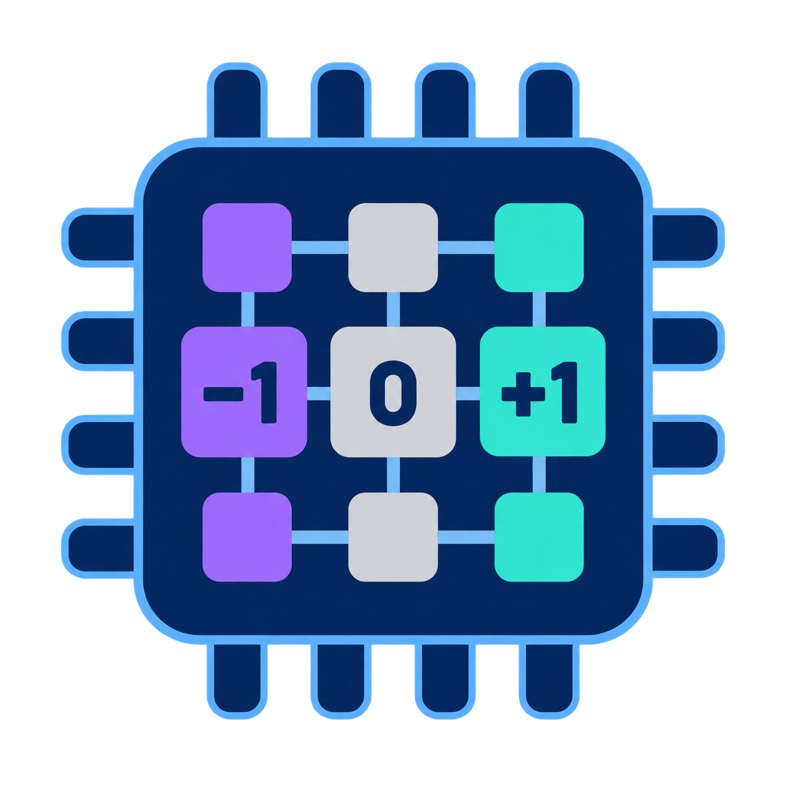

<div align="center">



# TernScope

### Model–Hardware Co-Design for Efficient Ternary Endoscopic Segmentation

Zhuoyu Wu · Wenhui Ou · Qiawei Zheng · Xuhong Qiu · Wenqi Fang · Raphaël C.-W. Phan

Monash University · HKUST · SIAT, CAS · Southeast University

[Why TernScope?](#why-ternscope) · [Network](#network) · [Hardware](#hardware) · [Evaluation](#evaluation) · [Get started](#getting-started)

</div>

---

**Included:** model code, Progressive QAT, one W2A8 inference checkpoint, and accelerator RTL. The manuscript has been submitted to arXiv; the public paper link will follow.

## Why TernScope?

**TernScope co-designs a segmentation model and accelerator to reduce model size, computation, and circuit area together.** Split-channel large kernels preserve spatial context for polyp segmentation, while a narrow decoder combines semantic features and boundary detail.

After branch fusion and progressive quantization, **all 25 convolutions—including the stem and prediction head—use ternary weights and 8-bit activations.** One ternary array therefore serves every convolution. Two-bit packing reduces weight traffic, sign selection replaces PE multiplication, and shared hardware handles scaling and multi-scale feature addition. These choices connect the network's numerical representation to the accelerator's storage and logic costs.

| Parameters | Computation | Deployment graph | Quantization |
| :---: | :---: | :---: | :---: |
| **0.2483 M** | **0.0949 GMACs** | **25 convolutions** | **W2A8** |

*At RGB 256 × 256, batch 1. Parameters exclude quantization scales; MACs exclude normalization, activations, and interpolation.*

## Network


| Design | What it changes | Why it matters |
| :--- | :--- | :--- |
| **SplitLK** | Applies large spatial kernels to a subset of channels, then mixes across channels. | Retains a wide receptive field with less spatial computation. |
| **Nearest Unifier** | Projects four encoder scales to 16 channels and fuses them through resizing and addition. | Combines semantic context and spatial detail while keeping the decoder narrow. |
| **Branch fusion + TPQ** | Merges training branches before progressively adapting the deployment graph to ternary weights. | Removes redundant inference paths and trains all 25 convolutions for W2A8 execution. |

**TPQ** is Ternary Progressive Quantization-aware Training: W8A8 adaptation, deep-to-shallow conversion through the encoder and decoder, then training of the fully W2A8 graph. Each output channel has a learned weight scale; biases, scaling, and accumulation retain wider precision.

## Hardware

**Ternary weights change the PE itself.** A weight code in {−1, 0, +1} selects a negated activation, zero, or the activation for accumulation. Two-bit packing cuts convolution-weight payload to **one quarter of INT8**. The shared **Affine & Quantization Engine** performs per-channel scaling, bias addition, feature addition, rounding, and saturation.

<div align="center">
  
</div>

The manuscript reports **88.46% less compute-array area** and **70.28% less standard-cell area** than the original Gemmini under matched **Nangate45 / Yosys–ABC synthesis**, with **16 × 16 PE arrays**. These gains combine ternary arithmetic, narrower accumulation, and simpler control. See the [hardware guide](hardware/README.md) for the supplied flow and checkpoint-specific configuration.

*Synthesis areas exclude SRAM macros, CPU, external DDR, clock-tree synthesis, and routing.*

## Evaluation

Training uses **Kvasir-SEG** with a fixed **720 / 80 / 200** train/validation/test split. External evaluation uses **CVC-ClinicDB (612 images)** and **CVC-ColonDB (380 images)** without fine-tuning.

Inputs are RGB 256 × 256. Dice and IoU are averaged per image at threshold 0.5; validation Dice selects checkpoints. TPQ uses FP32 initialization and no knowledge distillation.

## Getting started

```bash
python -m pip install -r software/requirements.txt
python software/smoke.py
python software/infer.py --image path/to/image.png --output runs/mask.png
```

The default inference weight is bundled. Training needs an external FP32 initializer; datasets are obtained separately.

| Directory | Contents |
| :--- | :--- |
| [software/](software/README.md) | Model, branch fusion, Progressive QAT, fixed split, inference and evaluation. |
| [weights/](weights/README.md) | One tensor-only W2A8 checkpoint and its training metadata. |
| [hardware/](hardware/README.md) | Final T300 RTL, integer reference, control generation, module tests and build scripts. |

The arXiv link and BibTeX entry will be added when the public record is available.

---

[Apache-2.0](LICENSE) · Contact: [Zhuoyu Wu](mailto:zhuoyu.wu@monash.edu)
