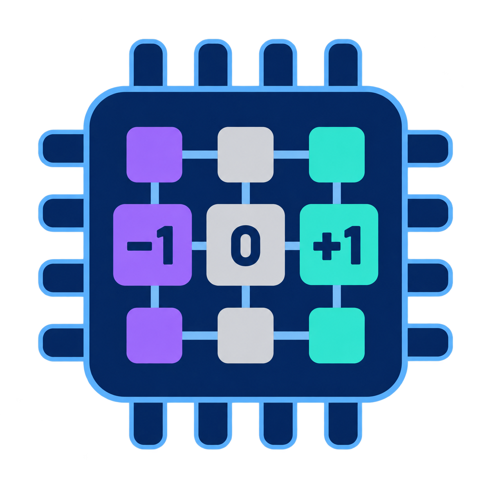
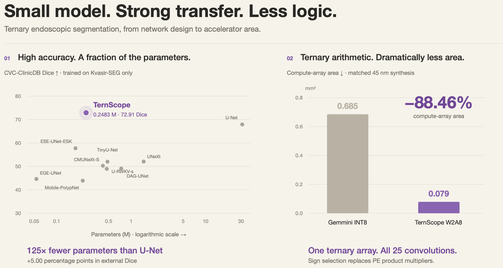
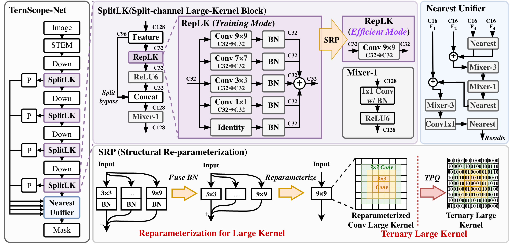
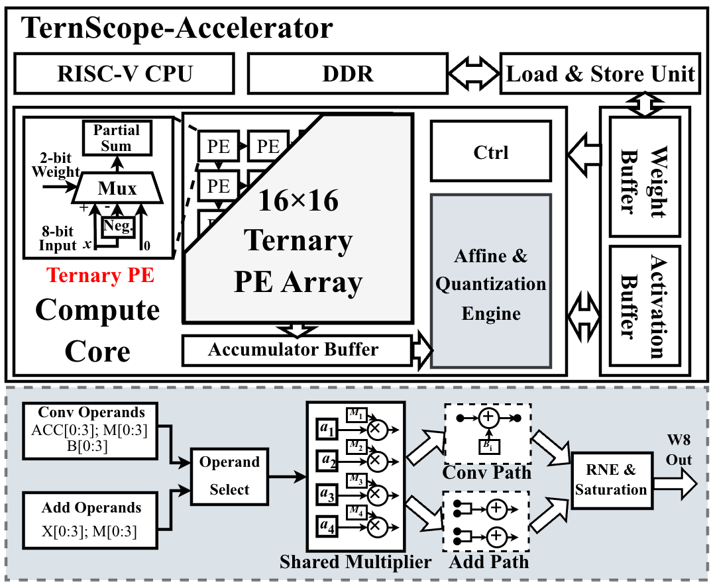

<div align="center">



# TernScope

### Model–Hardware Co-Design for Efficient Ternary Endoscopic Segmentation

Zhuoyu Wu · Wenhui Ou · Qiawei Zheng · Xuhong Qiu · Wenqi Fang · Raphaël C.-W. Phan

Monash University · HKUST · SIAT, CAS · Southeast University

[](https://arxiv.org/abs/2610.29617)

**[Read the paper](https://arxiv.org/abs/2610.29617) · [PDF](https://arxiv.org/pdf/2610.29617) · [Cite](#citation)**

[Highlights](#research-highlights) · [Why TernScope?](#why-ternscope) · [Network](#network) · [Hardware](#hardware) · [Evaluation](#evaluation) · [Leaderboard](#leaderboard-accuracy-vs-cost-paper-table-i) · [Get started](#getting-started)

</div>

---

**Included:** TernScope-Net, TPQ training, one W2A8 inference checkpoint, and accelerator RTL. Read the [paper on arXiv](https://arxiv.org/abs/2610.29617).

## Research highlights

**Tiny model. Ternary compute. Efficient polyp segmentation.**

- 🪶 **0.2483 M params · 0.0949 GMACs** — large-kernel context, tiny footprint.
- 🔢 **25/25 convolutions in W2A8** — fuse first, then learn ternary weights with TPQ.
- 🧠 **Model + hardware, co-designed** — packed weights and multiplier-free PE products.
- 🎯 **81.58% Dice** on Kvasir-SEG; **72.91% / 59.45%** on ClinicDB / ColonDB without fine-tuning.
- ⚡ **88.46% smaller compute array · 8.63× throughput** vs. Gemmini in the paper's matched 45 nm flow.

*Paper-reported results; protocols and hardware scope are detailed [below](#evaluation).*



## Why TernScope?

**TernScope co-designs a segmentation model and accelerator to reduce model size, computation, and circuit area together.** Split-channel large kernels preserve spatial context for polyp segmentation, while a narrow decoder combines semantic features and boundary detail.

After branch fusion and progressive quantization, **all 25 convolutions—including the stem and prediction head—use ternary weights and 8-bit activations.** One ternary array therefore serves every convolution. Two-bit packing reduces weight traffic, sign selection replaces PE multiplication, and shared hardware handles scaling and multi-scale feature addition. These choices connect the network's numerical representation to the accelerator's storage and logic costs.

|     Parameters     |      Computation      |     Deployment graph     |  Quantization  |
| :----------------: | :--------------------: | :-----------------------: | :------------: |
| **0.2483 M** | **0.0949 GMACs** | **25 convolutions** | **W2A8** |

*At RGB 256 × 256, batch 1. Parameters exclude quantization scales; MACs exclude normalization, activations, and interpolation.*

## Network



| Design                        | What it changes                                                                                 | Why it matters                                                                       |
| :---------------------------- | :---------------------------------------------------------------------------------------------- | :----------------------------------------------------------------------------------- |
| **SplitLK**             | Applies large spatial kernels to a subset of channels, then mixes across channels.              | Retains a wide receptive field with less spatial computation.                        |
| **Nearest Unifier**     | Projects four encoder scales to 16 channels and fuses them through resizing and addition.       | Combines semantic context and spatial detail while keeping the decoder narrow.       |
| **Branch fusion + TPQ** | Merges training branches before progressively adapting the deployment graph to ternary weights. | Removes redundant inference paths and trains all 25 convolutions for W2A8 execution. |

**TPQ** is Ternary Progressive Quantization-aware Training: W8A8 adaptation, deep-to-shallow conversion through the encoder and decoder, then training of the fully W2A8 graph. Each output channel has a learned weight scale; biases, scaling, and accumulation retain wider precision.

## Hardware

**Ternary weights change the PE itself.** A weight code in {−1, 0, +1} selects a negated activation, zero, or the activation for accumulation. Two-bit packing cuts convolution-weight payload to **one quarter of INT8**. The shared **Affine & Quantization Engine** performs per-channel scaling, bias addition, feature addition, rounding, and saturation.

<div align="center">
  
</div>

The manuscript reports **88.46% less compute-array area** and **70.28% less standard-cell area** than the original Gemmini under matched **Nangate45 / Yosys–ABC synthesis**, with **16 × 16 PE arrays**. These gains combine ternary arithmetic, narrower accumulation, and simpler control. See the [hardware guide](hardware/README.md) for the supplied flow and checkpoint-specific configuration.

*Synthesis areas exclude SRAM macros, CPU, external DDR, clock-tree synthesis, and routing.*

## Evaluation

Training uses **Kvasir-SEG** with a fixed **720 / 80 / 200** train/validation/test split. External evaluation uses **CVC-ClinicDB (612 images)** and **CVC-ColonDB (380 images)** without fine-tuning.

Inputs are RGB 256 × 256. Dice and IoU are averaged per image at threshold 0.5; validation Dice selects checkpoints. TPQ uses FP32 initialization and no knowledge distillation.

### Paper-reported segmentation results

| Dataset      | Evaluation                            |          Dice ↑ |           IoU ↑ |
| :----------- | :------------------------------------ | ---------------: | ---------------: |
| Kvasir-SEG   | Held-out test (200 images)            | **0.8158** | **0.7247** |
| CVC-ClinicDB | External, no fine-tuning (612 images) | **0.7291** | **0.6290** |
| CVC-ColonDB  | External, no fine-tuning (380 images) | **0.5945** | **0.5015** |

### Leaderboard: accuracy vs. cost (paper Table I)

All models are trained on **Kvasir-SEG only** under the same protocol; ClinicDB and ColonDB are external tests **without fine-tuning**. 🥇 best, 🥈 second-best per column.

| Model | Year | Params (M) ↓ | GMACs ↓ | W/A | Kvasir Dice ↑ | Kvasir IoU ↑ | → ClinicDB Dice ↑ | → ClinicDB IoU ↑ | → ColonDB Dice ↑ | → ColonDB IoU ↑ |
| :-- | :--: | --: | --: | :--: | --: | --: | --: | --: | --: | --: |
| U-Net | 2015 | 31.0317 | 48.1670 | 32/32 | 🥇 0.8208 | 🥇 0.7303 | 🥈 0.6791 | 🥈 0.5849 | 🥈 0.5360 | 🥈 0.4471 |
| UNeXt | 2022 | 1.4719 | 0.5620 | 32/32 | 0.7385 | 0.6435 | 0.5207 | 0.4274 | 0.3785 | 0.2999 |
| Mobile-PolypNet | 2022 | 0.2239 | 1.1380 | 32/32 | 0.5974 | 0.4720 | 0.4390 | 0.3269 | 0.2711 | 0.1887 |
| EGE-UNet | 2023 | 🥇 0.0534 | 🥇 0.0720 | 32/32 | 0.5882 | 0.4611 | 0.4464 | 0.3276 | 0.2804 | 0.1950 |
| CMUNeXt-S | 2024 | 0.4175 | 1.0120 | 32/32 | 0.7120 | 0.6076 | 0.5029 | 0.3954 | 0.3148 | 0.2436 |
| TinyU-Net | 2024 | 0.4811 | 1.5610 | 32/32 | 0.7329 | 0.6286 | 0.5201 | 0.4329 | 0.2768 | 0.2194 |
| U-RWKV-s | 2025 | 0.4704 | 0.9740† | 32/32 | 0.6727 | 0.5608 | 0.4895 | 0.3795 | 0.2752 | 0.2035 |
| DAG-UNet | 2025 | 0.7358 | 0.7760 | 32/32 | 0.6785 | 0.5565 | 0.4908 | 0.3781 | 0.2484 | 0.1778 |
| ESEUNet-ESK | 2026 | 🥈 0.1789 | 3.5190 | 32/32 | 0.7693 | 0.6775 | 0.5776 | 0.4759 | 0.4113 | 0.3333 |
| **TernScope-Net (ours)** | 2026 | 0.2483 | 🥈 **0.0949** | **2/8** | 🥈 **0.8158** | 🥈 **0.7247** | 🥇 **0.7291** | 🥇 **0.6290** | 🥇 **0.5945** | 🥇 **0.5015** |

**Takeaway:** with ~1/125 of U-Net's parameters and ~1/508 of its MACs, TernScope-Net stays within 0.51 points of U-Net's in-domain Dice and **leads every external test** (+5.00 / +5.85 Dice points on ClinicDB / ColonDB), while running all convolutions in W2A8.

*Per-image means at threshold 0.5, 256 × 256 input. TernScope's parameters exclude quantization scales. † WKV operators excluded; partial count. Also listed on [Papers with Code](https://paperswithcode.co/paper/2610.29617).*

### Paper-reported hardware results

| Metric                            | Original Gemmini |         TernScope |
| :-------------------------------- | ---------------: | ----------------: |
| Compute-array area (mm²)         |            0.685 |   **0.079** |
| Standard-cell area (mm²)         |            1.816 |   **0.540** |
| Throughput at 100 MHz (FPS)       |           11.902 | **102.701** |
| Estimated logic energy (mJ/image) |           14.019 |   **0.604** |

Both mappings use the same 25-convolution workload, 16 × 16 arrays, and Nangate45 synthesis. Logic energy uses OpenSTA vectorless power estimates; these are implementation-flow results rather than measured silicon or whole-system energy.

## Getting started

```bash
python -m pip install -r software/requirements.txt
python software/smoke.py
python software/infer.py --image path/to/image.png --output runs/mask.png
```

The default inference weight is bundled. Training needs an external FP32 initializer; datasets are obtained separately.

| Directory                    | Contents                                                                                |
| :--------------------------- | :-------------------------------------------------------------------------------------- |
| [software/](software/README.md) | TernScope-Net, branch fusion, TPQ, fixed split, inference and evaluation.               |
| [weights/](weights/README.md)   | One tensor-only W2A8 checkpoint and its training metadata.                              |
| [hardware/](hardware/README.md) | Accelerator RTL, integer reference, control generation, module tests and build scripts. |

## Citation

```bibtex
@misc{wu2026ternscope,
  title = {TernScope: Model-Hardware Co-Design for Efficient Ternary Endoscopic Segmentation},
  author = {Zhuoyu Wu and Wenhui Ou and Qiawei Zheng and Xuhong Qiu and Wenqi Fang and Raphaël C.-W. Phan},
  year = {2026},
  eprint = {2610.29617},
  archivePrefix = {arXiv},
  primaryClass = {eess.IV},
  url = {https://arxiv.org/abs/2610.29617}
}
```

---

[Apache-2.0](LICENSE) · Contact: [Zhuoyu Wu](mailto:zhuoyu.wu@monash.edu)
