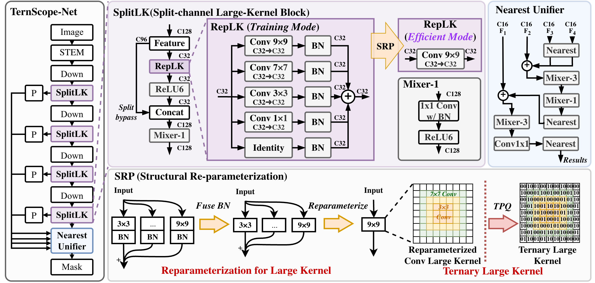
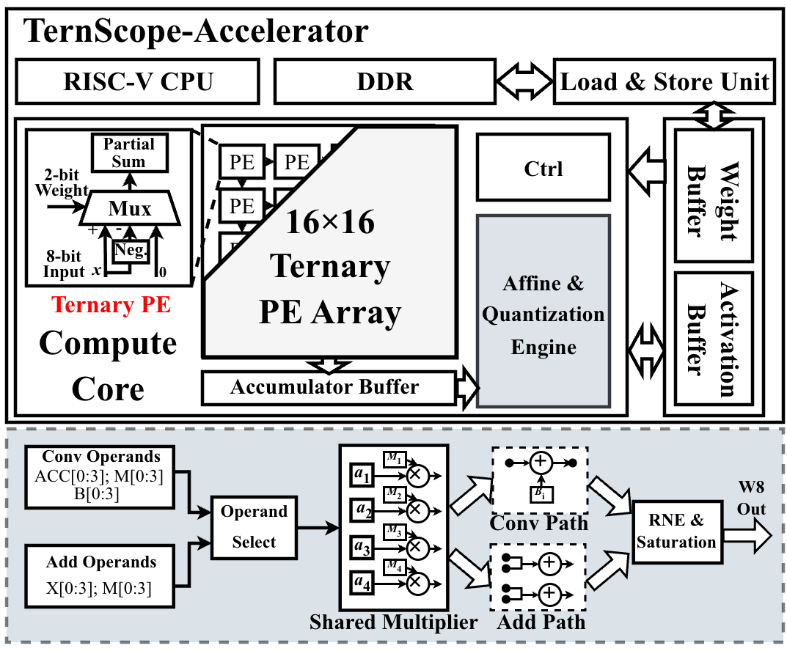

# TernScope

### Model–Hardware Co-Design for Efficient Ternary Endoscopic Segmentation

**Compact segmentation. Ternary computation. Co-designed hardware.**

Zhuoyu Wu · Wenhui Ou · Qiawei Zheng · Xuhong Qiu · Wenqi Fang · Raphael C.-W. Phan

Monash University Malaysia · HKUST · SIAT, Chinese Academy of Sciences · Southeast University

[Overview](#overview) · [Architecture](#architecture) · [Hardware](#hardware) · [Evaluation](#evaluation-protocol) · [Release status](#release-status) · [Citation](#citation)

---

> **Release in preparation.** The manuscript has been submitted to arXiv. We are preparing the model code, pretrained checkpoints, and hardware artifacts for release. This repository currently provides the project overview and architecture figures; runnable code and checkpoint downloads will be added as they become available.

## Overview

TernScope co-designs a lightweight segmentation network and a ternary accelerator for efficient endoscopic polyp segmentation. Split-channel large-kernel blocks capture spatial context, structural re-parameterization fuses training branches, and **Ternary Progressive Quantization-aware Training (TPQ)** adapts the deployment graph to ternary weights and 8-bit activations.

| Parameters | Computation | Deployment graph | Quantization |
| :---: | :---: | :---: | :---: |
| **0.2483 M** | **0.0949 GMACs** | **25 convolutions** | **W2A8** |

*Model statistics reported in the manuscript for a single RGB input at 256 × 256. Parameter count excludes additional quantization scales; MACs exclude normalization, activations, and interpolation.*

The design connects three stages:

1. **Build compact spatial context.** SplitLK applies large spatial kernels to a subset of channels; the Nearest Unifier combines multi-scale features at a narrow width.
2. **Fuse, then quantize.** Training branches merge into the deployment graph before TPQ progressively converts its convolution weights to ternary values.
3. **Map ternary operators to hardware.** A 16 × 16 PE array uses sign selection and accumulation, with shared hardware for affine transforms and requantization.

## Architecture

### SplitLK · Spatial context at low cost

Encoder stages use **32 / 64 / 96 / 128 channels**, while spatial convolutions process only **16 / 16 / 16 / 32 channels**. The remaining channels bypass spatial processing and rejoin the transformed features before pointwise mixing. Large kernels operate at lower spatial resolutions, where a wider receptive field is less expensive.

### Nearest Unifier · Narrow multi-scale fusion

All four encoder scales project to **16 channels**. Nearest-neighbor resizing aligns the features, and addition combines them without expanding the decoder width through concatenation. Convolutional refinement recovers spatial detail before the segmentation head.

### TPQ · Fuse first, then learn ternary execution

Batch normalization and parallel linear branches fuse into the deployment topology before quantization. TPQ then adapts the graph through W8A8, progressively converts layers from the deeper encoder toward the decoder and prediction layers, and finishes with the full W2A8 network. Validation Dice selects checkpoints from the fully W2A8 phase.

### Ternary execution

Each convolution weight is represented by a ternary code and a learned per-output-channel scale:

$$
\widehat{W}_c = s_c\,\operatorname{clip}\!\left(\operatorname{round}(W_c/s_c),\,-1,\,1\right), \qquad s_c > 0.
$$

For a ternary code $t \in \{-1, 0, +1\}$, the PE product $t \cdot a$ becomes **−a, 0, or +a**. General multipliers are removed from the PE product path. Per-channel scaling remains in the shared Affine & Quantization Engine.

**W2A8** denotes two-bit storage for the three weight codes and 8-bit activations. Biases, scales, and accumulation use wider precision.

## Hardware

  

The accelerator combines:

- A **16 × 16 ternary PE array** for sign selection and accumulation.
- **Packed two-bit weights** and 8-bit activation buffers.
- A shared **Affine & Quantization Engine** for per-channel scaling, bias, feature addition, rounding, and saturation.
- A **load/store unit** connecting on-chip buffers to external memory.

Under matched **Nangate45 / Yosys–ABC synthesis**, the manuscript reports an **88.46% reduction in compute-array area** relative to the original Gemmini with a 16 × 16 INT8 array. The result includes ternary arithmetic, narrower accumulation, and simpler control; array area excludes external SRAM macros, CPU, DDR, clock-tree synthesis, and routing.

## Evaluation protocol

Training uses **Kvasir-SEG only**. External evaluation measures transfer to ClinicDB and ColonDB without fine-tuning.

| Dataset | Role | Images |
| :--- | :--- | ---: |
| Kvasir-SEG | Training | 720 |
| Kvasir-SEG | Validation and checkpoint selection | 80 |
| Kvasir-SEG | Held-out testing | 200 |
| CVC-ClinicDB | External evaluation | 612 |
| CVC-ColonDB | External evaluation | 380 |

- **Input:** RGB, 256 × 256, normalized to [−1, 1].
- **Resizing:** bilinear for images; nearest-neighbor for masks.
- **Metrics:** per-image Dice and IoU, averaged over each evaluation set at threshold 0.5.
- **TPQ training:** FP32 initialization, AdamW, batch size 2, base learning rate 2 × 10⁻⁴, 200 epochs, and no knowledge distillation.

The release will include the fixed split, evaluation commands, and checkpoint identities alongside the implementation. Dataset images and masks should be obtained from their original providers under the applicable terms.

## Release status

| Component | Availability |
| :--- | :--- |
| Project overview and architecture figures | Available in this repository |
| Paper link and citation metadata | To be added when the arXiv record is public |
| Model implementation and branch fusion | In preparation |
| TPQ training and evaluation scripts | In preparation |
| Pretrained checkpoints and checksums | In preparation |
| Fixed data split and dataset preparation guide | In preparation |
| Accelerator RTL and simulation instructions | In preparation |
| Synthesis configuration and hardware result provenance | In preparation |

Installation, inference, and reproduction commands will be documented with the code release. Check the [repository releases](https://github.com/ReaganWu/TernScope/releases) for packaged artifacts.

## Citation

**TernScope: Model–Hardware Co-Design for Efficient Ternary Endoscopic Segmentation**

Zhuoyu Wu, Wenhui Ou, Qiawei Zheng, Xuhong Qiu, Wenqi Fang, and Raphael C.-W. Phan.

The manuscript has been submitted to arXiv. A direct paper link and BibTeX entry will be added when the public record is available.

## License and contact

This repository is licensed under the [Apache License 2.0](LICENSE). Third-party dependencies and datasets retain their respective licenses and terms.

For questions, use [GitHub Issues](https://github.com/ReaganWu/TernScope/issues). Research correspondence: **Zhuoyu Wu**, [zhuoyu.wu@monash.edu](mailto:zhuoyu.wu@monash.edu).

---

  TernScope · Model–hardware co-design for compact ternary segmentation

